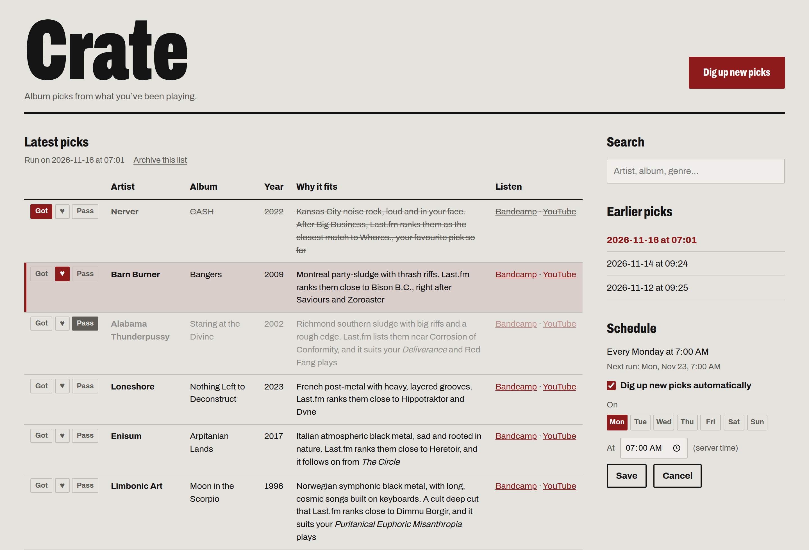

# Crate

A small self-hosted web page that suggests albums you probably haven't heard, based on what you've been listening to.



Press **Dig up new picks** and Crate runs your prompt through an AI model: [Claude Code](https://claude.com/claude-code) by default, or any OpenAI-compatible model (OpenRouter, OpenAI, Ollama, LM Studio) if you bring your own key. The model reads your [ListenBrainz](https://listenbrainz.org/) listening history, finds similar artists, checks your [Navidrome](https://www.navidrome.org/) library so it skips albums you already own, and returns a table of 10 picks. Each pick has Bandcamp and YouTube search links so you can preview it.

Then mark each pick:

- **Got**: you picked it up. The row turns green.
- **♥**: it really stood out. The row is highlighted.
- **Pass**: you previewed it and it's not for you. The row turns grey.

Your marks are fed back into every future run. Loved albums count most, Got albums count as liked, and passed albums are a mild "less of this" hint. Marked albums and anything from the last 12 runs are never suggested again.

Each list also gets a **preview playlist**: after a run, Crate downloads the 2 most popular songs from each album and plays them in a player at the bottom of the page. Press **▶ Play previews** under **Playlist** in the sidebar for all of them, **▶ Play** on a row for one album, or open **Show songs** to pick a song, and mark albums as you listen. Albums you've marked Got or Pass are skipped. See [Preview playlists](#preview-playlists).

Use **Search** in the sidebar to find a pick across all your lists, by artist, album, year or any word in the description.

To tidy up the sidebar, open a list and press **Archive this list**. Archived lists move to a collapsed "Archived" section, still show up in searches, and still count as suggested, so they won't come back. From there you can **Restore** a list or **Delete** it permanently. Deleting a list keeps your Got, ♥ and Pass marks.

To get new picks without pressing the button, open **Settings** (under the button) and set the **Schedule**: pick the days and a time, and Crate digs up picks on its own while it's running. Times use the server's clock.

## How it works

- `app.py`: a FastAPI server that serves the page, stores your prompt, marks and schedule, and starts each run, either when you press the button or on schedule. Each run is saved to `picks/YYYY-MM-DD_HHMM.md`, and archived lists move to `picks/archive/`.
- `previews.py`: builds each list's preview playlist with [yt-dlp](https://github.com/yt-dlp/yt-dlp) (see below).
- `agent.py`: the runner for the `openai` backend. Crate starts the MCP servers itself and passes tool calls between them and the model.
- `index.html`: the picks page, and `settings.html`: the prompt, schedule and accounts. Plain HTML with no build step.
- The prompt the model gets is your `prompt.md`, followed by your recent picks, then your loved, got and passed albums.

Either way, the model can only use the Navidrome, ListenBrainz and Last.fm tools: no shell, file edits or web access.

## Requirements

- [uv](https://docs.astral.sh/uv/) (installs the Python dependencies automatically)
- Node.js (`npx`), for the Navidrome MCP server. yt-dlp also needs it to get past YouTube's JavaScript checks when downloading previews.
- A Navidrome server
- A free [ListenBrainz](https://listenbrainz.org/) account with your listens in it. Navidrome can scrobble to ListenBrainz (turn it on under Personal in its web UI), and ListenBrainz can [import your Last.fm history](https://listenbrainz.org/settings/import/).
- Optional: a [Last.fm API key](https://www.last.fm/api/account/create). Last.fm is moving API access behind a paid plan, so Crate no longer depends on it, but the `lastfm` server is still set up if you have a key.
- One of:
  - [Claude Code](https://claude.com/claude-code), installed and logged in (`claude` on your PATH), for the default backend
  - An API key for any OpenAI-compatible provider, or a local model server, for the `openai` backend

## MCP servers

Crate gives the model three [MCP](https://modelcontextprotocol.io/) servers. Their commands are in `.mcp.example.json` (or your own `.mcp.json`, if you have one), and your accounts come from the settings page:

| Server | Package | What the model uses it for |
|---|---|---|
| `navidrome` | [navidrome-mcp](https://github.com/Blakeem/Navidrome-MCP) (npm) | Searching your library, so it skips albums you already own |
| `listenbrainz` | `listenbrainz_mcp.py` (in this repo) | Your listening history, similar artists, and artists' albums |
| `lastfm` | [lastfm-mcp](https://pypi.org/project/lastfm-mcp/) (PyPI) | Optional. Last.fm history and similar artists, if you have an API key |

You don't install them yourself. `npx` and `uv` download them the first time a run starts, so the first run takes a little longer.

On each run, Crate writes a private temporary MCP config with your saved accounts filled in and runs the model with only those servers. Last.fm is left out when there's no API key, and Navidrome when there's no address.

The ListenBrainz token is optional, but worth adding (it's on your [ListenBrainz settings page](https://listenbrainz.org/settings/)). With it, an artist's albums are ranked by how much people listen to them, preview songs are picked better, and Crate can scrobble. Without it, albums come from MusicBrainz, ordered by year.

ListenBrainz stats cover calendar periods (`this_month`, `quarter`, `this_year`, `all_time`, ...), not rolling windows. The tools default to `all_time`, and the model can look at shorter periods to see what you're into lately. New accounts and fresh imports can take a day or so before stats appear.

## Setup

```sh
git clone <this repo> crate
cd crate

# 1. Pick a backend (see "Choosing a model" below). The default, Claude Code,
#    needs nothing here. For your own model/key:
#    cp .env.example .env && $EDITOR .env

# 2. Start Crate
uv run app.py
```

Open <http://localhost:8095> and go to **Settings** (under the button):

1. Under **Accounts**, enter your ListenBrainz username and token, and optionally your Navidrome login and a Last.fm username and API key. Press **Test** on each, then **Save accounts**. They're saved in `settings.json` (readable only by you), and tokens and passwords aren't shown on the page again.
2. Edit the prompt if you like and press **Save prompt**. It starts from `prompt.example.md` and is saved to `prompt.md`.

If you already have a `.mcp.json` with your accounts in it, Crate copies them into `settings.json` the first time it starts. After that, `settings.json` is what runs use; `.mcp.json` is only read for the server commands, and for your own `claude` sessions in this folder.

To keep Crate running in the background, see `crate.service.example` for a systemd user service. Crate has to be running for scheduled runs to happen.

## Choosing a model

Crate's backend is set with `CRATE_*` settings, either in a `.env` file (copy `.env.example`) or as environment variables. Environment variables win over `.env`. Restart Crate after changing them.

**Claude Code (default).** Nothing to set. Uses your Claude Code login. Optional:
- `CRATE_CLAUDE_MODEL`: a model name for Claude Code's `--model` flag, e.g. `claude-sonnet-5-5`.
- `ANTHROPIC_API_KEY`: bill an Anthropic API key instead of a Claude subscription.

**Any OpenAI-compatible model (bring your own key).** Set:

```sh
CRATE_BACKEND=openai
CRATE_BASE_URL=https://openrouter.ai/api/v1   # or OpenAI, Ollama, LM Studio: see .env.example
CRATE_API_KEY=your-key                        # local servers accept any value
CRATE_MODEL=provider/model-name
```

Claude Code isn't needed for this backend. Crate runs the same MCP servers itself.

A run makes many ListenBrainz and Navidrome tool calls, so the model needs to be good at tool calling. Small local models often lose track partway through or return a broken table. With paid APIs, each run costs money: every tool call sends the conversation back to the model.

## Preview playlists

After each run, Crate makes a playlist of a couple of songs per pick, so you can hear them without leaving the page:

1. The songs are each album's most-played on ListenBrainz (this needs your ListenBrainz token). When ListenBrainz knows too little about an album, Crate takes its tracklist from MusicBrainz and ranks the songs by YouTube views.
2. yt-dlp finds each song on YouTube, skipping live versions, covers and videos whose length doesn't match the album version, and downloads only the audio (Opus or AAC, about 130 kbps). ffmpeg isn't needed.
3. The audio and a `playlist.json` go in `previews/<run>/`. Nothing is added to Navidrome or to any YouTube account.

A playlist takes a few minutes to build, and the page shows songs as they arrive. Archiving or deleting a list deletes its previews. **Make playlist** above a list builds one again, for example for a list from before this feature or one you restored. Previews take about 3–5 MB a song.

YouTube changes often, and an old yt-dlp stops working. `crate.service.example` starts Crate with `uv run --upgrade-package yt-dlp app.py`, which checks for a newer yt-dlp on every start. Do the same if you start Crate by hand.

**Scrobbling.** With a ListenBrainz token saved, the player scrobbles what you hear: ListenBrainz shows the song as playing now when it starts, and records a listen once you've heard half of it or 4 minutes, whichever comes first. Skipping ahead doesn't count toward that. Listens are sent by Crate's server, so your token never reaches the browser. If ListenBrainz is down, they're kept in `listens.pending.json` and sent with the next one. Turn it off under **Accounts** in Settings. Keep in mind that scrobbled previews become part of the listening history future picks are based on.

Matching isn't perfect: now and then a song is the wrong version or the wrong band. Downloading from YouTube is also against YouTube's terms. These are short-lived previews for deciding what to buy.

## Settings

Near the top of `app.py`:

| Setting | Default | What it does |
|---|---|---|
| `PORT` | `8095` | The port the page is served on |
| `HISTORY_RUNS` | `12` | How many past runs the model sees, so it doesn't repeat itself |
| `TIMEOUT_SECONDS` | `900` | How long a run can take before it's stopped |
| `SONGS_PER_ALBUM` (in `previews.py`) | `2` | How many songs per pick go in the preview playlist |

The server listens on all network interfaces and has no login: anyone who can open the page can run picks and change your settings and accounts (though not read your saved tokens or passwords). Run it on a trusted network, or put it behind a reverse proxy with authentication.

## Your data stays local

These files hold credentials or personal listening data. They're git-ignored and never committed:
`settings.json`, `.mcp.json`, `.env`, `prompt.md`, `marks.json`, `schedule.json`, `listens.pending.json`, `picks/`, `previews/`.
